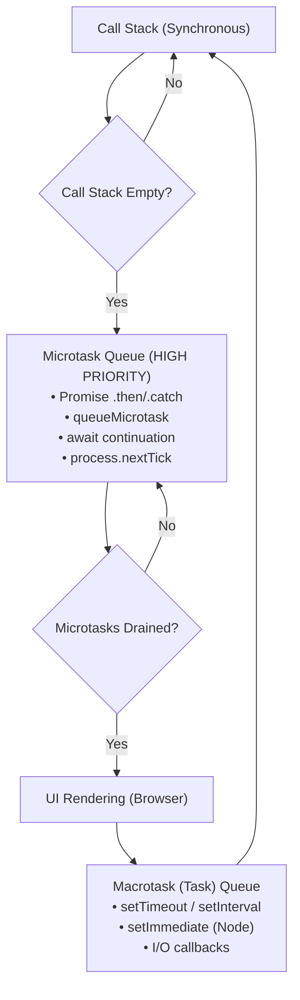

# 🚀 JavaScript Interview Preparation Master Guide & Notes

A comprehensive, production-grade JavaScript interview preparation repository. Packed with in-depth concept explanations, runnable coding interview questions, high-frequency output-prediction puzzles, design patterns, and rock-solid polyfills handling every edge case tested by top tech companies.

---

## 📑 Table of Contents

1. [📂 Repository Directory Structure](#-repository-directory-structure)
2. [⚡ 10-Minute Rapid Revision "Golden Rules"](#-10-minute-rapid-revision-golden-rules)
3. [🧠 Deep Dive Core Concepts](#-deep-dive-core-concepts)
   - [1. Execution Context, Hoisting & TDZ](#1-execution-context-hoisting--tdz)
   - [2. Scopes & Closures](#2-scopes--closures)
   - [3. Function Currying & Partial Application](#3-function-currying--partial-application)
   - [4. The `this` Keyword & Explicit Binding (`call`, `apply`, `bind`)](#4-the-this-keyword--explicit-binding-call-apply-bind)
   - [5. Objects & Memory (Shallow vs Deep Clone)](#5-objects--memory-shallow-vs-deep-clone)
   - [6. Array Methods & Interview Quirks](#6-array-methods--interview-quirks)
   - [7. Promises, Async/Await & Microtasks](#7-promises-asyncawait--microtasks)
   - [8. The JavaScript Event Loop & Task Queues](#8-the-javascript-event-loop--task-queues)
   - [9. Prototypes & Prototypal Inheritance](#9-prototypes--prototypal-inheritance)
   - [10. DOM Architecture, Propagation & Delegation](#10-dom-architecture-propagation--delegation)
   - [11. Type Coercion & Equality Matrix](#11-type-coercion--equality-matrix)
   - [12. Essential JavaScript Design Patterns](#12-essential-javascript-design-patterns)
4. [🛠️ Master Polyfill Reference Table](#️-master-polyfill-reference-table)
5. [🎯 Top 30 Tricky Output-Based Interview Questions](#-top-30-tricky-output-based-interview-questions)
6. [💻 How to Run & Verify Code](#-how-to-run--verify-code)

---

## 📂 Repository Directory Structure

Every topic in this repository is accompanied by working code samples and practice questions:

```
Interview/
├── README.md                                    # Master Interview Guide & Revision Sheet
├── Polyfills.js                                 # Consolidated Polyfill Cheatsheet
├── Hoisting.js                                  # Hoisting & Temporal Dead Zone
├── Memoization.js                               # Caching & Optimization via Closures
├── ImpliciteBinding.js                          # Object Method Binding
├── ExplicteBinding.js                           # call(), apply(), bind() Intro
│
├── ArraysMethod/                                # Array Methods & Manipulations
│   ├── Map.js                                   # map() & myMap polyfill
│   ├── Filter.js                                # filter() & myFilter polyfill
│   ├── Reduce.js                                # reduce() & myReduce polyfill
│   ├── NewReduc3.js                             # Alternate reduce edge cases
│   ├── forEach.js                               # forEach loop behavior
│   └── ArrayInterviewTricks.js                  # sort trap, slice vs splice, deduplication
│
├── Closures/                                    # Closures & Scope Chain
│   ├── Closures.js                              # Definition, inner functions, chains
│   ├── LexicalScope.js                          # Lexical environment breakdown
│   └── Practice.js                              # Private counters, module pattern, timers
│
├── Curring/                                     # Function Currying
│   ├── Basic.js                                 # Currying intro and rationale
│   └── Practice.js                              # sum(a)(b)(c), infinite curry, generic curry()
│
├── DOM/                                         # DOM Manipulation & Browser APIs
│   ├── EventDelegation_Propagation.html         # Interactive bubbling/capturing & delegation demo
│   ├── DOM_Interview_Questions.js               # Reflow, repaint, CustomEvent, CRP
│   ├── index.html                               # Layout practice
│   └── practice.html                            # Event listener practice
│
├── EventLoop/                                   # Asynchronous Concurrency Model
│   └── EventLoop_Practice.js                    # Microtasks vs Macrotasks, async/await sequence
│
├── Functions/                                   # Function Types & Scopes
│   ├── Basic.js                                 # First-class functions, IIFEs, expressions
│   ├── Scope.js                                 # Block vs function scope, var vs let loops
│   ├── ArrowFunction.js                         # Lexical this, arguments object, syntax
│   └── asyncFunctions.js                        # async/await, generators, parallel execution
│
├── Objects/                                     # Object Internals & Manipulation
│   ├── Basic.js                                 # Property access, dynamic keys, destructuring
│   └── Practice.js                              # Output puzzles, freeze vs seal, deep clone
│
├── Polyfills/                                   # Dedicated Polyfill Implementations
│   ├── call.js                                  # Function.prototype.myCall
│   ├── Apply.js                                 # Function.prototype.myApply
│   ├── Bind.js                                  # Function.prototype.myBind (supports 'new')
│   ├── PromiseAll.js                            # Promise.myPromiseAll
│   ├── PromiseCombinators.js                    # all, allSettled, race, any
│   ├── DebounceThrottle.js                      # Debounce & Throttle with cancel/immediate
│   ├── Flat.js                                  # Array.prototype.myFlat & myFlatMap
│   ├── DeepClone.js                             # Recursive WeakMap deep clone
│   └── setTimeout.js                            # Custom interval & timers
│
├── Promise/                                     # Promises & Async Programming
│   ├── Basic.js                                 # Promise creation, chaining, catch
│   └── InterviewTricks.js                       # Sequential promise runner, retry with backoff
│
├── Prototype/                                   # Prototypes & Inheritance
│   ├── index.js                                 # ES5 inheritance vs ES6 class, null prototype
│   ├── Prototype.js                             # Constructor functions, hasOwnProperty
│   └── interviewQuestions.js                    # __proto__ vs prototype vs [[Prototype]]
│
├── this/                                        # 'this' Keyword Mastery
│   ├── Basic.js                                 # Global, object, class, chained calculator
│   ├── Call.js                                  # Borrowing methods with call
│   ├── Apply.js                                 # Passing arguments with apply
│   └── Practice.js                              # Tricky output questions on this
│
├── Coercion/                                    # Type Coercion & Comparisons
│   └── TypeCoercion.js                          # ToPrimitive, == vs ===, null triangle
│
└── DesignPatterns/                              # System Design & Code Patterns
    ├── EventEmitter_PubSub.js                   # Pub-Sub / EventEmitter class
    └── Singleton_Module_Observer.js             # Singleton, Revealing Module, Observer
```

---

## ⚡ 10-Minute Rapid Revision "Golden Rules"

| Topic | The Core Rule Interviewers Want to Hear |
| :--- | :--- |
| **Hoisting** | Declarations are hoisted to the top of their scope, NOT initializations. `var` initializes to `undefined`; `let` and `const` enter the **Temporal Dead Zone (TDZ)** until declaration line. |
| **Closures** | A function bundled together with references to its surrounding lexical environment. It remembers variables from outer scopes even after the outer function has returned. |
| **`this` Binding** | Determined strictly by **HOW** a function is called, not where it is defined (except arrow functions, which inherit `this` lexically from their enclosing scope). |
| **Event Loop** | Drains the **entire Microtask Queue** (Promise callbacks, `queueMicrotask`, `process.nextTick`) before running the next **Macrotask** (`setTimeout`, `setInterval`, I/O). |
| **Equality (`==` vs `===`)** | `===` compares both type and value without coercion. `==` performs type coercion via `ToNumber` / `ToPrimitive`. `null == undefined` is `true`. |
| **Prototypes** | `obj.__proto__` points to `Constructor.prototype`. The chain terminates at `Object.prototype.__proto__ === null`. |
| **Array Mutability** | `push/pop/splice/sort/reverse` **mutate** in place. `slice/concat/map/filter` return **new arrays**. |
| **Object Cloning** | Shallow clone (`{ ...obj }`) copies primitive values, but nested objects still share memory references. Use `structuredClone` or recursive clone with `WeakMap` for deep copies. |

---

## 🧠 Deep Dive Core Concepts

### 1. Execution Context, Hoisting & TDZ
- **Global Execution Context (GEC):** Created when script starts. Sets up `window`/`globalThis` and `this`.
- **Two Phases:**
  1. **Creation Phase:** Memory allocated for variables and functions. Function declarations are stored completely in memory. `var` is allocated with `undefined`. `let`/`const` are allocated uninitialized (TDZ).
  2. **Execution Phase:** Code executes line by line; assignments and function calls take place.
- **Temporal Dead Zone (TDZ):** The period between entering scope and variable declaration where accessing `let` or `const` throws a `ReferenceError`.

📁 Practice: [Hoisting.js](file:///c:/Users/shriv/Desktop/Interview/Hoisting.js)

---

### 2. Scopes & Closures
- **Scopes:** Global Scope, Function (Local) Scope, Block Scope (introduced in ES6 with `let`/`const`).
- **Lexical Environment:** Local memory + Reference to lexical environment of parent.
- **Top Closure Use Cases:**
  1. Data privacy / Encapsulation (Private counters, Module pattern).
  2. Function factories / Currying (`createBase(6)`).
  3. Maintaining state in asynchronous callbacks (e.g. event handlers, debounce/throttle).
  4. Memoization / Cache stores.

📁 Practice:
- [Closures.js](file:///c:/Users/shriv/Desktop/Interview/Closures/Closures.js)
- [LexicalScope.js](file:///c:/Users/shriv/Desktop/Interview/Closures/LexicalScope.js)
- [Practice.js](file:///c:/Users/shriv/Desktop/Interview/Closures/Practice.js)
- [Memoization.js](file:///c:/Users/shriv/Desktop/Interview/Memoization.js)

---

### 3. Function Currying & Partial Application
- **Currying:** Transforming a function that takes multiple arguments `f(a, b, c)` into a sequence of unary functions `f(a)(b)(c)`.
- **Infinite Currying:** Function continues returning itself while arguments exist, and evaluates when invoked empty:
  ```javascript
  function add(a) {
    return function (b) {
      if (b !== undefined) return add(a + b);
      return a;
    };
  }
  add(1)(2)(3)(4)(); // 10
  ```
- **Generic `curry(fn)`:** Checks `args.length >= fn.length` to invoke original function or return accumulator.

📁 Practice:
- [Basic.js](file:///c:/Users/shriv/Desktop/Interview/Curring/Basic.js)
- [Practice.js](file:///c:/Users/shriv/Desktop/Interview/Curring/Practice.js)

---

### 4. The `this` Keyword & Explicit Binding (`call`, `apply`, `bind`)

The 4 Rules of `this` Determination (in precedence order):
1. **`new` Binding:** Inside a constructor invoked with `new`, `this` refers to the newly created instance.
2. **Explicit Binding:** Set manually via `.call(context, ...args)`, `.apply(context, [args])`, or `.bind(context, ...args)`.
3. **Implicit Binding:** When invoked as a method of an object (`obj.method()`), `this` refers to `obj`.
4. **Default Binding:** Standalone function invocation `fn()`. In strict mode (`"use strict"`), `this` is `undefined`; in non-strict mode, it points to `window`/`globalThis`.

> [!IMPORTANT]
> **Arrow Functions:** Do NOT have their own `this`, `arguments`, or `prototype`. They look up `this` lexically from their enclosing scope at definition time. Calling `.call()`, `.apply()`, or `.bind()` on an arrow function does not change its `this`!

📁 Practice:
- [this/Basic.js](file:///c:/Users/shriv/Desktop/Interview/this/Basic.js)
- [this/Practice.js](file:///c:/Users/shriv/Desktop/Interview/this/Practice.js)
- [ImpliciteBinding.js](file:///c:/Users/shriv/Desktop/Interview/ImpliciteBinding.js)
- [ExplicteBinding.js](file:///c:/Users/shriv/Desktop/Interview/ExplicteBinding.js)

---

### 5. Objects & Memory (Shallow vs Deep Clone)
- **Object.freeze() vs Object.seal():**
  - `Object.freeze()`: Read-only shallowly. Cannot add, delete, or modify properties.
  - `Object.seal()`: Cannot add or delete properties, but **can** modify existing writable properties.
- **Deep Cloning Limitations of `JSON.parse(JSON.stringify(obj))`:**
  - Omits `undefined`, `Function`, `Symbol`.
  - Converts `Date` to ISO string.
  - Converts `RegExp` to empty object `{}`.
  - Converts `NaN` / `Infinity` to `null`.
  - **Crashes on circular references** (`TypeError: Converting circular structure to JSON`).
- **Solution:** Use native `structuredClone(obj)` or custom recursive deep clone with `WeakMap`.

📁 Practice:
- [Objects/Basic.js](file:///c:/Users/shriv/Desktop/Interview/Objects/Basic.js)
- [Objects/Practice.js](file:///c:/Users/shriv/Desktop/Interview/Objects/Practice.js)
- [Polyfills/DeepClone.js](file:///c:/Users/shriv/Desktop/Interview/Polyfills/DeepClone.js)

---

### 6. Array Methods & Interview Quirks
- **`sort()` Trap:** Default sorting compares string UTF-16 code units. `[10, 5, 100].sort()` gives `[10, 100, 5]`. Always pass comparator `(a, b) => a - b`.
- **`slice(start, end)` vs `splice(start, count, ...items)`:** `slice` is pure and non-mutating; `splice` alters the array in place and returns deleted elements.
- **`map` vs `forEach`:** `map` allocates and returns a new array; `forEach` returns `undefined` and is used solely for side-effects.

📁 Practice:
- [Map.js](file:///c:/Users/shriv/Desktop/Interview/ArraysMethod/Map.js)
- [Filter.js](file:///c:/Users/shriv/Desktop/Interview/ArraysMethod/Filter.js)
- [Reduce.js](file:///c:/Users/shriv/Desktop/Interview/ArraysMethod/Reduce.js)
- [ArrayInterviewTricks.js](file:///c:/Users/shriv/Desktop/Interview/ArraysMethod/ArrayInterviewTricks.js)

---

### 7. Promises, Async/Await & Microtasks
- **3 States:** `pending`, `fulfilled`, `rejected`. Once settled, a promise's state is immutable.
- **Chaining & Error Handling:** Errors bubble down the chain until caught by a `.catch()`. Returning a value inside `.then()` wraps it in a resolved Promise.
- **The 4 Promise Combinators:**
  1. `Promise.all`: Fails fast on first rejection. Resolves when all succeed.
  2. `Promise.allSettled`: Never rejects. Waits for all to settle with `{ status, value/reason }`.
  3. `Promise.race`: Settles with the result of whichever promise settles first (fulfilled OR rejected).
  4. `Promise.any`: Resolves with the first fulfilled promise. Rejects with `AggregateError` only if all reject.

📁 Practice:
- [Promise/Basic.js](file:///c:/Users/shriv/Desktop/Interview/Promise/Basic.js)
- [Promise/InterviewTricks.js](file:///c:/Users/shriv/Desktop/Interview/Promise/InterviewTricks.js)
- [Polyfills/PromiseCombinators.js](file:///c:/Users/shriv/Desktop/Interview/Polyfills/PromiseCombinators.js)

---

### 8. The JavaScript Event Loop & Task Queues



**Execution Priority:** Synchronous Code ➔ Microtasks (until queue is completely empty) ➔ Render ➔ ONE Macrotask ➔ Repeat.

📁 Practice: [EventLoop_Practice.js](file:///c:/Users/shriv/Desktop/Interview/EventLoop/EventLoop_Practice.js)

---

### 9. Prototypes & Prototypal Inheritance
- Every JavaScript object has an internal `[[Prototype]]` link.
- `__proto__` is the historical getter/setter on `Object.prototype` exposing `[[Prototype]]`. Modern standard: `Object.getPrototypeOf(obj)`.
- `ConstructorFunction.prototype` is the prototype object assigned to instances created via `new ConstructorFunction()`.
- Objects created via `Object.create(null)` have no prototype, no `toString`, and are immune to prototype pollution.

📁 Practice:
- [Prototype/index.js](file:///c:/Users/shriv/Desktop/Interview/Prototype/index.js)
- [Prototype/Prototype.js](file:///c:/Users/shriv/Desktop/Interview/Prototype/Prototype.js)
- [Prototype/interviewQuestions.js](file:///c:/Users/shriv/Desktop/Interview/Prototype/interviewQuestions.js)

---

### 10. DOM Architecture, Propagation & Delegation
- **Event Flow:**
  1. **Capturing Phase (Trickling):** Window ➔ Document ➔ Body ➔ Target.
  2. **Target Phase:** Handler on clicked element.
  3. **Bubbling Phase:** Target ➔ Body ➔ Document ➔ Window (Default in `addEventListener`).
- **Event Methods:**
  - `e.stopPropagation()`: Stops the event from propagating up or down the DOM tree.
  - `e.stopImmediatePropagation()`: Stops propagation AND prevents other listeners on the **same element** from firing.
  - `e.preventDefault()`: Prevents default browser actions (form submit, link navigation).
- **Event Delegation:** Attaching a single listener to a common parent using `event.target.closest('selector')` instead of attaching listeners to hundreds of child elements.

📁 Practice:
- [EventDelegation_Propagation.html](file:///c:/Users/shriv/Desktop/Interview/DOM/EventDelegation_Propagation.html)
- [DOM_Interview_Questions.js](file:///c:/Users/shriv/Desktop/Interview/DOM/DOM_Interview_Questions.js)

---

### 11. Type Coercion & Equality Matrix

- `+` with string: Concatenates (`"1" + 2` ➔ `"12"`).
- `-`, `*`, `/`: Arithmetic numbers (`"6" - 2` ➔ `4`).
- `[] + []` ➔ `""` (both convert to empty strings).
- `[] + {}` ➔ `"[object Object]"`
- `![]` ➔ `false` (arrays are truthy objects).
- `[] == ![]` ➔ `true` (`[] == false` ➔ `"" == 0` ➔ `0 == 0`).
- The `null` comparison triangle:
  - `null > 0` ➔ `false` (coerced to 0)
  - `null == 0` ➔ `false` (null only equals null or undefined in loose comparison)
  - `null >= 0` ➔ `true` (relational operator coerces null to 0: 0 >= 0 is true!)

📁 Practice: [TypeCoercion.js](file:///c:/Users/shriv/Desktop/Interview/Coercion/TypeCoercion.js)

---

### 12. Essential JavaScript Design Patterns
1. **Pub-Sub / EventEmitter:** Decoupled event bus with `.on()`, `.off()`, `.emit()`, and `.once()`.
2. **Singleton Pattern:** Enforces a single instance (e.g. Database connection or configuration manager).
3. **Module Pattern:** Encapsulates private state and exports public APIs using closures.
4. **Observer Pattern:** Subject notifies an array of subscribed observer callbacks on state changes.

📁 Practice:
- [EventEmitter_PubSub.js](file:///c:/Users/shriv/Desktop/Interview/DesignPatterns/EventEmitter_PubSub.js)
- [Singleton_Module_Observer.js](file:///c:/Users/shriv/Desktop/Interview/DesignPatterns/Singleton_Module_Observer.js)

---

## 🛠️ Master Polyfill Reference Table

| Method | Prototype Signature | Key Interview Edge Cases to Handle | File Link |
| :--- | :--- | :--- | :--- |
| **`map`** | `Array.prototype.myMap(cb, thisArg)` | Sparse arrays (`i in this`), passes `(item, index, array)` | [Map.js](file:///c:/Users/shriv/Desktop/Interview/ArraysMethod/Map.js) |
| **`filter`** | `Array.prototype.myFilter(cb, thisArg)` | Truthy evaluation, skips deleted or empty indices | [Filter.js](file:///c:/Users/shriv/Desktop/Interview/ArraysMethod/Filter.js) |
| **`reduce`** | `Array.prototype.myReduce(cb, initial)` | Empty array with no initial throws TypeError, start index 0 vs 1 | [Reduce.js](file:///c:/Users/shriv/Desktop/Interview/ArraysMethod/Reduce.js) |
| **`flat`** | `Array.prototype.myFlat(depth = 1)` | Recursion depth, `Infinity`, ignores sparse holes | [Flat.js](file:///c:/Users/shriv/Desktop/Interview/Polyfills/Flat.js) |
| **`call`** | `Function.prototype.myCall(ctx, ...args)` | `null/undefined` defaults to `globalThis`, primitive boxing, Symbol property | [call.js](file:///c:/Users/shriv/Desktop/Interview/Polyfills/call.js) |
| **`apply`** | `Function.prototype.myApply(ctx, args)` | Validates array-like args, cleans up temporary Symbol | [Apply.js](file:///c:/Users/shriv/Desktop/Interview/Polyfills/Apply.js) |
| **`bind`** | `Function.prototype.myBind(ctx, ...args)` | **`new` operator override**, partial application / currying, prototype link | [Bind.js](file:///c:/Users/shriv/Desktop/Interview/Polyfills/Bind.js) |
| **`Promise.all`** | `Promise.myPromiseAll(iterable)` | Empty iterable resolves `[]`, non-promise values wrapped, fail-fast on 1st reject | [PromiseAll.js](file:///c:/Users/shriv/Desktop/Interview/Polyfills/PromiseAll.js) |
| **`Promise.allSettled`** | `Promise.myAllSettled(iterable)` | Never rejects, maps to `{ status: 'fulfilled', value }` or `{ status: 'rejected', reason }` | [PromiseCombinators.js](file:///c:/Users/shriv/Desktop/Interview/Polyfills/PromiseCombinators.js) |
| **`Promise.race`** | `Promise.myRace(iterable)` | First settled (fulfilled OR rejected) wins | [PromiseCombinators.js](file:///c:/Users/shriv/Desktop/Interview/Polyfills/PromiseCombinators.js) |
| **`Promise.any`** | `Promise.myAny(iterable)` | First fulfilled wins; if all reject, throws `AggregateError` | [PromiseCombinators.js](file:///c:/Users/shriv/Desktop/Interview/Polyfills/PromiseCombinators.js) |
| **`debounce`** | `debounce(fn, delay, immediate)` | Immediate leading call option, `cancel()` method, maintains `this` and `args` | [DebounceThrottle.js](file:///c:/Users/shriv/Desktop/Interview/Polyfills/DebounceThrottle.js) |
| **`throttle`** | `throttle(fn, limit)` | Timestamp + timeout hybrid to ensure trailing call executes | [DebounceThrottle.js](file:///c:/Users/shriv/Desktop/Interview/Polyfills/DebounceThrottle.js) |
| **`deepClone`** | `deepClone(obj, hash = new WeakMap())` | Handles circular references, Date, RegExp, Maps, Sets, Symbols | [DeepClone.js](file:///c:/Users/shriv/Desktop/Interview/Polyfills/DeepClone.js) |
| **`setInterval`** | `mySetInterval(fn, delay)` | Uses `setTimeout` recursively, returns ID, `myClearInterval` cancels | [setTimeout.js](file:///c:/Users/shriv/Desktop/Interview/Polyfills/setTimeout.js) |

---

## 🎯 Top 30 Tricky Output-Based Interview Questions

<details>
<summary><b>1. Variable Hoisting with <code>var</code></b></summary>

```javascript
console.log(a);
var a = 10;
```
**Output:** `undefined`  
**Why:** Only the declaration `var a;` is hoisted to the top and initialized to `undefined`. The assignment `a = 10;` happens at runtime.
</details>

<details>
<summary><b>2. Function Declaration vs Variable Hoisting</b></summary>

```javascript
foo();
var foo = 20;
function foo() {
  console.log("Called foo!");
}
foo();
```
**Output:**
```
Called foo!
TypeError: foo is not a function
```
**Why:** Function declarations are hoisted above variable declarations. `foo` is initially the function. After `foo = 20;` executes, `foo` is a number, so calling `foo()` throws a TypeError.
</details>

<details>
<summary><b>3. The Classic <code>for</code> loop with <code>var</code> vs <code>let</code></b></summary>

```javascript
for (var i = 0; i < 3; i++) {
  setTimeout(() => console.log("var:", i), 100);
}
for (let j = 0; j < 3; j++) {
  setTimeout(() => console.log("let:", j), 100);
}
```
**Output:**
```
var: 3
var: 3
var: 3
let: 0
let: 1
let: 2
```
**Why:** `var` is function-scoped; all three callbacks close over the same single `i` variable which is 3 when the timers fire. `let` is block-scoped; each iteration creates a new lexical environment binding for `j`.
</details>

<details>
<summary><b>4. Closures & Variable Shadowing</b></summary>

```javascript
let count = 0;
(function () {
  if (count === 0) {
    let count = 1;
    console.log(count);
  }
  console.log(count);
})();
```
**Output:**
```
1
0
```
**Why:** The `let count = 1;` inside the `if` block shadows the outer `count` within that block only. Outside the block, outer `count` remains 0.
</details>

<details>
<summary><b>5. Objects as Keys in Plain Objects</b></summary>

```javascript
const a = {};
const b = { key: "b" };
const c = { key: "c" };
a[b] = 123;
a[c] = 456;
console.log(a[b]);
```
**Output:** `456`  
**Why:** Plain object property keys must be strings or symbols. Both `b` and `c` are coerced to `"[object Object]"`. Thus `a["[object Object]"]` is set to 123 and then overwritten with 456.
</details>

<details>
<summary><b>6. Arrow Function <code>this</code> inside Object</b></summary>

```javascript
const user = {
  name: "Saksham",
  getName: () => this.name,
  getRealName() {
    return this.name;
  },
};
console.log(user.getName());
console.log(user.getRealName());
```
**Output:**
```
undefined
Saksham
```
**Why:** Arrow functions do not bind their own `this`. `getName` inherits `this` from its outer/module scope (where `name` is undefined). `getRealName` uses implicit binding to `user`.
</details>

<details>
<summary><b>7. <code>bind</code> Chaining Trick</b></summary>

```javascript
function f() {
  console.log(this.name);
}
f = f.bind({ name: "Mohan" }).bind({ name: "Sohan" });
f();
```
**Output:** `Mohan`  
**Why:** A function bound with `.bind()` creates an exotic bound function whose `this` context is permanently fixed to the first target. Subsequent `.bind()` calls cannot override the original bound context.
</details>

<details>
<summary><b>8. Microtask vs Macrotask Order</b></summary>

```javascript
console.log(1);
setTimeout(() => console.log(2), 0);
Promise.resolve().then(() => console.log(3));
queueMicrotask(() => console.log(4));
console.log(5);
```
**Output:** `1, 5, 3, 4, 2`  
**Why:** Synchronous logs `1` and `5` run first. Microtasks (`3` and `4`) are flushed before macrotask `2`.
</details>

<details>
<summary><b>9. <code>async/await</code> Execution Order</b></summary>

```javascript
async function test() {
  console.log(1);
  await null;
  console.log(2);
}
console.log(3);
test();
console.log(4);
```
**Output:** `3, 1, 4, 2`  
**Why:** Synchronous script prints 3. `test()` starts synchronously, printing 1. At `await null`, the remainder of `test()` is queued as a microtask. Synchronous script prints 4. Finally, microtask prints 2.
</details>

<details>
<summary><b>10. Array Comparison</b></summary>

```javascript
console.log([] == []);
console.log([] === []);
```
**Output:** `false, false`  
**Why:** Arrays are reference types in JavaScript. Two distinct array literals occupy separate memory locations, so reference equality is false.
</details>

<details>
<summary><b>11. Array Coercion Trick <code>[] == ![]</code></b></summary>

```javascript
console.log([] == ![]);
```
**Output:** `true`  
**Why:** `![]` coerces truthy array `[]` to boolean `false`. Then `[] == false` triggers loose equality rules: `[]` becomes `""`, then `0`. `false` becomes `0`. `0 == 0` is `true`.
</details>

<details>
<summary><b>12. The <code>null</code> Relational Comparison</b></summary>

```javascript
console.log(null > 0);
console.log(null == 0);
console.log(null >= 0);
```
**Output:** `false, false, true`  
**Why:** Relational comparisons (`>`, `>=`) convert `null` to number `0` (so `0 >= 0` is true). Equality check (`==`) follows distinct rules where `null` only equals `undefined` or `null`.
</details>

<details>
<summary><b>13. <code>typeof NaN</code> and <code>NaN === NaN</code></b></summary>

```javascript
console.log(typeof NaN);
console.log(NaN === NaN);
console.log(Object.is(NaN, NaN));
```
**Output:**
```
number
false
true
```
**Why:** By IEEE-754 standard, `NaN` is a special numeric value that is not equal to anything, including itself. `Object.is` implements SameValue equality which evaluates `NaN` equal to `NaN`.
</details>

<details>
<summary><b>14. Array <code>sort()</code> Default Behavior</b></summary>

```javascript
const arr = [1, 2, 10, 20, 5];
console.log(arr.sort());
```
**Output:** `[1, 10, 2, 20, 5]`  
**Why:** Elements are converted to strings and sorted according to UTF-16 code points ("10" comes before "2").
</details>

<details>
<summary><b>15. Array Length Truncation</b></summary>

```javascript
const nums = [1, 2, 3, 4, 5];
nums.length = 2;
console.log(nums);
```
**Output:** `[1, 2]`  
**Why:** Decreasing the `length` property of an array destructively truncates its elements.
</details>

<details>
<summary><b>16. <code>delete</code> Operator on Variables vs Properties</b></summary>

```javascript
var x = 1;
delete x;
const obj = { y: 2 };
delete obj.y;
console.log(x, obj.y);
```
**Output:** `1, undefined`  
**Why:** `delete` only deletes properties of objects. It cannot delete variables declared with `var`, `let`, or `const`.
</details>

<details>
<summary><b>17. IIFE Scope Chain</b></summary>

```javascript
(function (x) {
  return (function (y) {
    console.log(x);
  })(2);
})(1);
```
**Output:** `1`  
**Why:** The inner function searches its own local scope for `x`; failing that, it looks up the scope chain to the outer function scope where `x` is 1.
</details>

<details>
<summary><b>18. Floating Point Precision</b></summary>

```javascript
console.log(0.1 + 0.2 === 0.3);
console.log(0.1 + 0.2);
```
**Output:**
```
false
0.30000000000000004
```
**Why:** JavaScript numbers are 64-bit binary floating-point (IEEE-754). Binary representations of decimal fractions like 0.1 and 0.2 have repeating decimals, resulting in rounding errors.
</details>

<details>
<summary><b>19. Function Length Property</b></summary>

```javascript
function fn(a, b, c = 10, d) {}
console.log(fn.length);
```
**Output:** `2`  
**Why:** `fn.length` returns the number of arguments expected *before* the first parameter with a default value.
</details>

<details>
<summary><b>20. Nested <code>setTimeout</code> vs <code>setInterval</code></b></summary>

```javascript
// Why is recursive setTimeout preferred over setInterval for variable network calls?
```
**Answer:** `setInterval` fires callbacks at fixed clock intervals regardless of how long the async operation inside took, potentially stacking callbacks. Nested `setTimeout` guarantees a fixed delay *after* the previous operation finishes executing.
</details>

<details>
<summary><b>21. Constructor Function Returning an Object vs Primitive</b></summary>

```javascript
function A() {
  this.name = "A";
  return { name: "B" };
}
function C() {
  this.name = "C";
  return "D";
}
console.log(new A().name);
console.log(new C().name);
```
**Output:** `B, C`  
**Why:** When invoked with `new`, if the constructor returns an **object**, that object becomes the result. If it returns a **primitive** (like `"D"`), the return value is discarded and `this` is returned.
</details>

<details>
<summary><b>22. <code>+0 === -0</code> vs <code>Object.is(+0, -0)</code></b></summary>

```javascript
console.log(+0 === -0);
console.log(Object.is(+0, -0));
```
**Output:** `true, false`  
**Why:** Strict equality `===` treats `+0` and `-0` as equal. `Object.is` distinguishes positive and negative zero.
</details>

<details>
<summary><b>23. Object Spread Shallow Copy Trap</b></summary>

```javascript
const user = { details: { age: 20 } };
const clone = { ...user };
clone.details.age = 30;
console.log(user.details.age);
```
**Output:** `30`  
**Why:** Spread syntax (`...`) only creates a shallow clone. Nested objects continue to share the exact same reference.
</details>

<details>
<summary><b>24. <code>arguments</code> in Arrow Functions</b></summary>

```javascript
function outer() {
  const inner = () => console.log(arguments[0]);
  inner(20);
}
outer(10);
```
**Output:** `10`  
**Why:** Arrow functions do not have their own `arguments` object; they resolve `arguments` lexically from their enclosing regular function (`outer`).
</details>

<details>
<summary><b>25. <code>Promise.race</code> with Empty Array</b></summary>

```javascript
Promise.race([]).then(() => console.log("Done"));
```
**Output:** *(Nothing ever logs)*  
**Why:** `Promise.race([])` returns a Promise that stays `pending` forever because no promise ever settles.
</details>

<details>
<summary><b>26. Number Coercion with Unary Plus</b></summary>

```javascript
console.log(+"");
console.log(+true);
console.log(+null);
console.log(+undefined);
```
**Output:** `0, 1, 0, NaN`  
**Why:** Unary `+` coerces values to numbers via `ToNumber`. `undefined` coerces to `NaN`, whereas `null` and `""` coerce to 0.
</details>

<details>
<summary><b>27. <code>Object.freeze</code> vs Nested Mutation</b></summary>

```javascript
const config = { db: { host: "localhost" } };
Object.freeze(config);
config.db.host = "192.168.1.1";
console.log(config.db.host);
```
**Output:** `"192.168.1.1"`  
**Why:** `Object.freeze()` is **shallow**. It does not freeze nested objects unless you implement deep freeze recursively.
</details>

<details>
<summary><b>28. <code>Promise.all</code> Fail Fast</b></summary>

```javascript
Promise.all([
  Promise.resolve(1),
  Promise.reject("Err"),
  new Promise((res) => setTimeout(() => res(3), 1000)),
])
  .then(console.log)
  .catch(console.error);
```
**Output:** `"Err"` (immediately, without waiting for the 1000ms timer)  
**Why:** `Promise.all` rejects immediately upon the first rejection without waiting for other pending promises to settle.
</details>

<details>
<summary><b>29. <code>typeof typeof 1</code></b></summary>

```javascript
console.log(typeof typeof 1);
```
**Output:** `"string"`  
**Why:** `typeof 1` returns `"number"` (a string). `typeof "number"` returns `"string"`.
</details>

<details>
<summary><b>30. <code>Object.prototype.__proto__</code></b></summary>

```javascript
console.log(Object.prototype.__proto__);
```
**Output:** `null`  
**Why:** `Object.prototype` is the end of the prototype chain. Its prototype link points to `null`.
</details>

---

## 💻 How to Run & Verify Code

All JavaScript files in this repository can be executed directly using Node.js or run in browser dev tools:

```bash
# Run individual topic files:
node Hoisting.js
node Closures/Practice.js
node Curring/Practice.js
node EventLoop/EventLoop_Practice.js
node Objects/Practice.js
node Coercion/TypeCoercion.js
node ArraysMethod/ArrayInterviewTricks.js
node DesignPatterns/EventEmitter_PubSub.js

# Run master polyfills:
node Polyfills.js
node Polyfills/Bind.js
node Polyfills/PromiseCombinators.js
node Polyfills/DebounceThrottle.js
node Polyfills/DeepClone.js
node Polyfills/Flat.js

# Test all files in workspace with PowerShell:
Get-ChildItem -Recurse -Filter *.js | ForEach-Object { node $_.FullName }
```

For DOM event flow and event delegation:
- Open [`DOM/EventDelegation_Propagation.html`](file:///c:/Users/shriv/Desktop/Interview/DOM/EventDelegation_Propagation.html) directly in any modern web browser.

---

⭐ **Happy Interview Preparation! Master these concepts, practice the polyfills, and you will ace any JavaScript technical round!**

